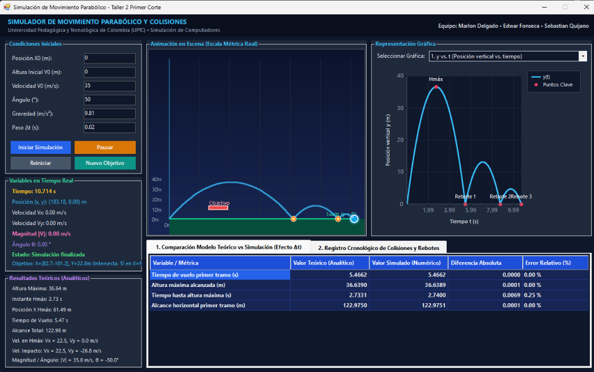

# Parabolic Motion & Collision Simulator 🎯

[](https://learn.microsoft.com/en-us/dotnet/csharp/)
[](https://dotnet.microsoft.com/)
[](https://learn.microsoft.com/en-us/dotnet/desktop/winforms/)
[](https://opensource.org/licenses/MIT)
[](https://www.uptc.edu.co/)

> A high-precision 2D projectile kinematics and multi-stage collision physics engine developed in **C#** and **Windows Forms**. Designed to model classical Newtonian ballistic trajectories, continuous collision detection with airborne target platforms, kinetic restitution with energy dissipation, and detailed analytical vs. numerical error analysis.

---

## 📸 Interface Preview



---

## 🌟 Key Highlights

- **Physics-Accurate Kinematic Engine:** Numerical integration of equations of motion using discrete temporal steps ($\Delta t$).
- **Continuous Collision Detection (CCD):** Sub-step linear interpolation accurately pinpoints impacts with airborne horizontal targets without tunneling artifacts.
- **Dynamic Restitution & Energy Loss:** Realistic momentum dissipation ($40\%$ magnitude loss, vertical velocity reversal) following physical rebound laws across consecutive impacts.
- **7 Kinematic Graph Representations:** Real-time plotting of trajectory, position, velocity components, speed magnitude, and trajectory angles against time.
- **Analytical vs. Numerical Telemetry:** Comprehensive comparison table displaying analytical formulas, simulated values, absolute error, and relative error ($\%$) to analyze the numerical effect of $\Delta t$.
- **Cyber-Dark Ergonomic UI:** Custom GDI+ metric canvas with coordinate mapping, real-time velocity vector arrows, trajectory glowing trails, and dedicated tabbed telemetry views.
- **Defensive Anti-Crash Architecture:** Complete input sanitization, domain boundary checks, and overflow protection against extreme parameters, division-by-zero, and `NaN`/`Infinity` states.

---

## 📐 Mathematical & Physical Modeling

The simulation models two-dimensional projectile motion under constant downward gravitational acceleration ($g$) neglecting atmospheric aerodynamic drag ($a_x = 0, a_y = -g$).

### 1. Classical Kinematic Equations
Given initial coordinates $(x_0, y_0)$, initial launch speed $v_0$, and launch angle $\theta$:

$$\begin{aligned}
v_{0x} &= v_0 \cos(\theta) \\
v_{0y} &= v_0 \sin(\theta)
\end{aligned}$$

The continuous position and velocity functions over time $t$ are governed by:

$$\begin{aligned}
x(t) &= x_0 + v_{0x} t \\
y(t) &= y_0 + v_{0y} t - \frac{1}{2} g t^2 \\
v_x(t) &= v_{0x} \\
v_y(t) &= v_{0y} - g t \\
|v(t)| &= \sqrt{v_x(t)^2 + v_y(t)^2}, \quad \theta(t) = \operatorname{atan2}(v_y(t), v_x(t))
\end{aligned}$$

### 2. Analytical Benchmarks
- **Time to Peak Height ($H_{\text{max}}$):**
  $$t_{H\text{max}} = \frac{v_{0y}}{g}$$
- **Maximum Height Reached:**
  $$H_{\text{max}} = y_0 + \frac{v_{0y}^2}{2g}$$
- **Horizontal Position at Peak Height:**
  $$X_{H\text{max}} = x_0 + v_{0x} \cdot t_{H\text{max}}$$
- **Total Flight Time (Ground Level $y = 0$):**
  $$t_{\text{flight}} = \frac{v_{0y} + \sqrt{v_{0y}^2 + 2 g y_0}}{g}$$
- **Maximum Range (First Stage):**
  $$X_{\text{total}} = x_0 + v_{0x} \cdot t_{\text{flight}}$$

### 3. Collision & Rebound Dynamics
When crossing the horizontal plane of an obstacle ($y = Y_{\text{obj}}$) or the ground plane ($y = 0$):
1. **Sub-Step Impact Interpolation:**
   $$\alpha = \frac{y_k - Y_{\text{plane}}}{y_k - y_{k+1}}, \quad x_{\text{impact}} = x_k + \alpha (x_{k+1} - x_k), \quad t_{\text{impact}} = t_k + \alpha \Delta t$$
2. **Kinetic Dissipation & Vector Inversion:**
   Per the physics specification, each collision experiences a **40% velocity magnitude reduction** (coefficient of restitution $e = 0.60$), reversing vertical velocity direction:
   $$\begin{aligned}
   v_{x,\text{after}} &= 0.60 \cdot v_{x,\text{impact}} \\
   v_{y,\text{after}} &= -\operatorname{sign}(v_{y,\text{impact}}) \cdot 0.60 \cdot |v_{y,\text{impact}}|
   \end{aligned}$$
3. **Multi-Stage Lifecycle:**
   $$\text{Launch} \longrightarrow \text{Airborne Target Collision} \longrightarrow \text{Ground Impact 1} \longrightarrow \text{Ground Impact 2} \longrightarrow \text{Rest at Final Impact}$$

---

## 📊 Analytical vs. Simulated Comparative Matrix

The application provides real-time telemetry comparing analytical predictions against numerical Euler integration:

| Monitored Metric | Theoretical Formulation | Simulated Measurement | Error Metrics |
| :--- | :--- | :--- | :--- |
| **First-Stage Flight Time ($s$)** | $t_{\text{flight}} = \frac{v_{0y} + \sqrt{v_{0y}^2 + 2gy_0}}{g}$ | Monitored timestamp at $y = 0$ | $|\text{Teo} - \text{Sim}|$, Rel. Error $\%$ |
| **Maximum Height ($m$)** | $H_{\text{max}} = y_0 + \frac{v_{0y}^2}{2g}$ | Peak recorded vertical coordinate | $|\text{Teo} - \text{Sim}|$, Rel. Error $\%$ |
| **Time to Peak Height ($s$)** | $t_{H\text{max}} = \frac{v_{0y}}{g}$ | Timestamp at peak vertical coordinate | $|\text{Teo} - \text{Sim}|$, Rel. Error $\%$ |
| **Horizontal Range ($m$)** | $X_{\text{total}} = x_0 + v_{0x} \cdot t_{\text{flight}}$ | First impact horizontal displacement | $|\text{Teo} - \text{Sim}|$, Rel. Error $\%$ |

---

## 📈 Supported Kinematic Charts

Selectable dynamically from the top-right visualization dashboard:

1. **$y$ vs. $t$:** Vertical displacement over time, illustrating asymmetric projectile descent and subsequent rebound arcs.
2. **$x$ vs. $t$:** Horizontal displacement over time, showing steady uniform motion and velocity attenuation at rebounds.
3. **$y$ vs. $x$:** Physical Cartesian trajectory plane, tracking trajectory arcs, peak heights, target impact, and ground impacts.
4. **$v_x$ vs. $t$:** Horizontal velocity step attenuation across successive collision events.
5. **$v_y$ vs. $t$:** Vertical velocity profile showing constant downward slope ($-g$) and instantaneous sign inversions at collision points.
6. **$|v|$ vs. $t$:** Total speed magnitude evolution highlighting kinetic energy dissipation.
7. **$\theta$ vs. $t$:** Instantaneous trajectory angle in degrees showing parabolic angle decay.

---

## 🏗️ Architecture & Clean Design

The software adheres strictly to separation of concerns:

```
SimuladorMovimientoParabolico/
│
├── SimuladorMovimientoParabolico.sln    # Universal Visual Studio Solution (VS 2019/2022)
├── SimuladorMovimientoParabolico.slnx   # Modern Visual Studio Solution Format
│
└── SimuladorMovimientoParabolico/
    ├── SimuladorFisico.cs              # Pure Mathematical & Physics Simulation Engine
    ├── Form1.cs                        # Event Controller, Telemetry & Animation Rendering
    ├── Form1.Designer.cs               # Declarative Windows Forms UI Design
    ├── Form1.resx                      # Form Resources
    ├── Program.cs                      # Application Entry Point
    └── App.config                      # Runtime Application Configuration
```

- **`SimuladorFisico.cs`:** Completely decoupled physics library managing state vectors, analytical calculations, target generation, and rebound kinematics. Zero dependency on Windows Forms GUI elements.
- **`Form1.cs`:** UI coordinator handling high-frequency timer ticks (`timer1_Tick`), safe coordinate mapping (`MapX`, `MapY`), defensive input validation (`ValidarEntradas`), and chart telemetry binding.
- **`Form1.Designer.cs`:** Pure declarative UI structure built using native Visual Studio Toolbox controls (`TabControl`, `DataGridView`, `Chart`, `PictureBox`, `GroupBox`), strictly adhering to academic constraints against code-generated UI controls.

---

## 🚀 Getting Started

### Prerequisites
- **Operating System:** Windows 10 or Windows 11.
- **Runtime:** .NET Framework 4.7.2 or higher.
- **Development Tool:** Visual Studio 2019 / 2022 with the *.NET Desktop Development* workload (or .NET SDK CLI).

### Quickstart / Build & Run

1. **Clone the repository:**
   ```bash
   git clone https://github.com/Marlonnxz/Parabolic-motion-and-collision-simulator..git
   cd Parabolic-motion-and-collision-simulator.
   ```

2. **Build via .NET CLI:**
   ```bash
   dotnet build SimuladorMovimientoParabolico.sln -c Release
   ```

3. **Run the Application:**
   ```bash
   .\SimuladorMovimientoParabolico\bin\Release\SimuladorMovimientoParabolico.exe
   ```
   *(Or simply open `SimuladorMovimientoParabolico.sln` in Visual Studio and press `F5`)*.

---

## 👥 Authors & Academic Credits

Developed for the **Computer Simulation (Simulación de Computadores)** course at **Universidad Pedagógica y Tecnológica de Colombia (UPTC)**:

- **Marlon Delgado** — [@Marlonnxz](https://github.com/Marlonnxz)
- **Edwar Fonseca**
- **Sebastian Quijano**

---

## 📄 License

This project is licensed under the **MIT License** — see the [LICENSE](LICENSE) file for details.
